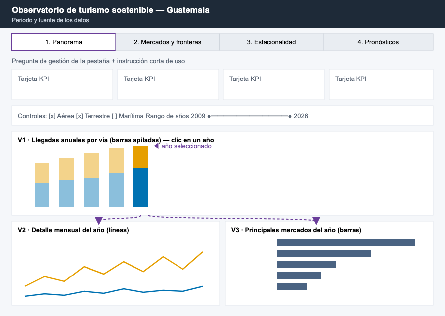
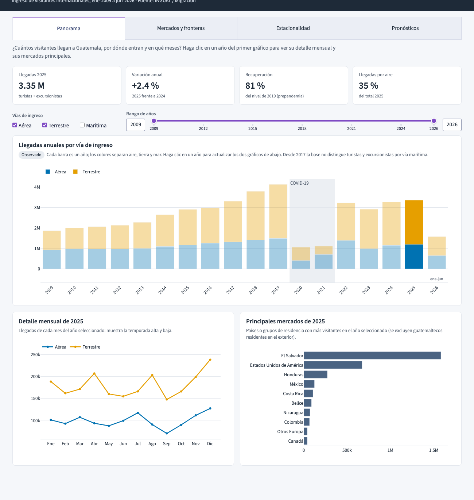

# 1. Contexto y usuarios

El tablero forma parte del **observatorio de turismo sostenible de Guatemala**. Usa la base de
**ingreso de visitantes internacionales** (INGUAT / Migración, ene-2009 a jun-2026) y los modelos de
pronóstico del Laboratorio 1. Está dirigido a **directivos del sector turístico** que no necesariamente
conocen estadística: cada vista abre con la pregunta que responde y una instrucción corta de uso.

Repositorio: <https://github.com/nicoCT04/Lab10-DataSicence>

# 2. Preguntas de gestión seleccionadas

| # | Pregunta de gestión | Para qué la usa un directivo | Vistas |
|--|----------------|----------------|------|
| P1 | ¿Cómo evolucionan las llegadas y cuánto se ha recuperado el turismo frente a 2019? | Fijar metas anuales y medir la recuperación pospandemia | KPIs, V1 |
| P2 | ¿En qué meses se concentra la demanda (temporada alta y baja)? | Planificar capacidad, personal y campañas para temporada baja; anticipar la presión estacional sobre los destinos | V2, V7, V8 |
| P3 | ¿Qué mercados de origen aportan más visitantes y cómo cambia su peso? | Priorizar la promoción y medir la dependencia de pocos mercados | V3, V5 |
| P4 | ¿Por qué vías y puntos fronterizos ingresan los visitantes? | Priorizar inversión en infraestructura y servicios de frontera | V1, V6 |
| P5 | ¿Qué tan confiables son las estimaciones de llegadas y qué modelo conviene como referencia? | Decidir cuánto confiar en un pronóstico al presupuestar | V4, V9, tabla de modelos |

# 3. Alcance del tablero

**Incluye**

- Llegadas mensuales de **turistas + excursionistas** (la definición estable de todo el periodo, igual
  que en el Lab 1), por año, mes, vía de ingreso, frontera y mercado de residencia.
- Resultados de **tres modelos sencillos del Laboratorio 1**: ARIMA(1,1,1), Holt-Winters y Seasonal
  Naive, para las series Total, Aérea y Terrestre, con el mismo split 70/30 (entrenamiento hasta mar-2021).
  **No se entrenan modelos nuevos**: `src/models.py` reproduce las mismas especificaciones y obtiene las
  mismas métricas del Lab 1 (p. ej., MAE del ARIMA sobre el Total = 154,494).
- Mínimo **8 visualizaciones interactivas**, con al menos 2 enlazadas y con control del nivel de detalle
  (año → mes, región → país, rango de fechas).

**No incluye / limitaciones**

- Indicadores de gasto, ocupación hotelera, empleo o impacto ambiental: la base solo registra llegadas.
  La concentración estacional se usa como **aproximación** de la presión sobre los destinos.
- Vía marítima: desde 2017 la base no separa turistas y excursionistas por esta vía; solo se muestra
  hasta donde existe ese dato.
- 2026 contiene solo ene-jun; se marca como año parcial.
- Los datos permiten describir **patrones**, no atribuir causas. Los pronósticos se presentan como
  **estimaciones** distinguidas visualmente de lo observado.

# 4. Herramienta seleccionada: Plotly Dash (Python)

| Criterio | Plotly Dash | Streamlit | R Shiny | Voilà / Panel |
|--------|--------|--------|-------|-------|
| Gráficos enlazados por clic | Nativo (`clickData` + callbacks) | Limitado, re-ejecuta todo el script | Sí | Parcial |
| Zoom / nivel de detalle | Nativo en Plotly (zoom, range slider, treemap) | Vía Plotly | Vía plotly/ggiraph | Vía Bokeh/Plotly |
| Reutiliza el código del Lab 1 | Sí (Python, statsmodels) | Sí | No (Lab 1 en Python) | Sí |
| Control del diseño (CSS, paleta) | Total (CSS propio) | Limitado | Alto | Medio |
| Licencia | MIT, gratuita | Apache 2.0 | GPL | BSD |

Se eligió **Dash** porque el requisito central son las **visualizaciones enlazadas**: un callback
conecta el clic en un gráfico con la actualización de otros, sin recargar la página. Además, el modelado
de los Labs 1 y 2 está en Python, por lo que los modelos se reutilizan sin traducirlos, y el CSS propio
permite aplicar la paleta y la tipografía con el mismo significado en todo el tablero.

# 5. Paleta de colores y tipografía

| Rol | Color | Uso y justificación |
|-------|-------|------------------|
| Tinta / Observado | `#1E2A38` | Encabezado, textos y la línea de **datos observados**. Azul casi negro: máximo contraste (AA) sin la dureza del negro puro. |
| Vía Aérea | `#0072B2` | Paleta **Okabe-Ito**, diseñada para ser distinguible con daltonismo. Azul = aire. |
| Vía Terrestre | `#E69F00` | Naranja tierra, opuesto al azul en el círculo cromático (complementario): máxima separación entre las dos vías principales. |
| Vía Marítima | `#009E73` | Verde azulado = mar; tercer color Okabe-Ito. |
| Magnitud sin categoría | `#4A6382` | Azul gris neutro para rankings (mercados), así no se confunde con ninguna vía. |
| Estimaciones (modelos) | `#6A3D9A`, `#CC79A7`, `#8C8C8C` | Morado, rosa y gris, tonos que **nunca** se usan para datos observados; además cada modelo tiene su tipo de línea (continua, raya-punto, punteada), así no depende solo del color. |
| Contexto | `#ECEFF3` | Franja gris para periodos especiales (COVID-19, periodo de evaluación). |
| Fondo / tarjetas | `#F5F7FA` / `#FFFFFF` | Fondo claro de baja saturación para que el color se reserve a los datos. |
| Alerta | `#E69F00` borde + `#FFF8EC` | Avisos de limitaciones. |

**Reglas**: (1) un color significa lo mismo en todas las pestañas; (2) la selección se resalta con
opacidad (seleccionado al 100 %, resto al 35 %) en lugar de introducir colores nuevos; (3) las
etiquetas *Observado* y *Estimado* separan hallazgos de estimaciones.

**Tipografía**: *Source Sans 3* (Google Fonts, licencia libre), sans serif humanista de alta
legibilidad en pantalla. Jerarquía: título 24 px, título de gráfico 17 px, cuerpo 15 px, ayudas y ejes
13 px. Los ejes usan sufijos (1M, 250k) para leer cifras grandes de un vistazo.

# 6. Bosquejo de la interfaz y navegación

{width=92%}

La navegación sigue el orden en que un directivo se hace las preguntas: **de lo general a lo
particular** y de lo observado a lo estimado.

1. **Panorama** (P1, P2, P4): KPIs, controles globales (vías y rango de años) y V1 → V2/V3 enlazadas.
2. **Mercados y fronteras** (P3, P4): treemap región → país (acercar o alejar el nivel de detalle) enlazado
   con las fronteras de ingreso.
3. **Estacionalidad** (P2): mapa de calor año × mes y perfil mensual.
4. **Pronósticos** (P5): observado vs. estimado, error por mes y tabla comparativa de modelos, con el
   aviso de limitaciones.

Cada pestaña sigue la misma plantilla: pregunta → KPIs → controles → gráficos con texto de ayuda.
Cuando un filtro deja un gráfico sin datos, este muestra un mensaje que lo explica en vez de un gráfico vacío.

# 7. Visualizaciones (estado del avance)

| # | Visualización | Tipo y por qué | Interacción | Estado |
|--|------|---------|--------|----|
| V1 | Llegadas anuales por vía | Barras apiladas: compara totales anuales y la composición por vía | Clic en un año (filtra V2 y V3), filtro de vías, rango de años, tooltip | **Funcional** |
| V2 | Detalle mensual del año | Líneas: la secuencia de meses muestra la temporada alta y baja | Enlazada a V1, filtro de vías, zoom | **Funcional** |
| V3 | Principales mercados del año | Barras horizontales ordenadas: ranking con nombres largos legibles | Enlazada a V1, tooltip con % | **Funcional** |
| V4 | Observado vs. estimado | Líneas temporales con franja de evaluación | Serie, modelos visibles, range slider, botones 5 años / todo | **Funcional** |
| V5 | Mercados por región → país | Treemap: jerarquía y proporción; clic para acercar o alejar | Drill-down, enlazada con V6 | Pendiente |
| V6 | Llegadas por frontera | Barras horizontales: ranking de puntos de ingreso | Enlazada a V5 | Pendiente |
| V7 | Calendario de llegadas | Mapa de calor año × mes: patrones estacionales de 17 años de un vistazo | Tooltip, filtro de vía | Pendiente |
| V8 | Perfil estacional | Boxplot por mes: variabilidad de cada mes entre años | Filtro de vía y periodo | Pendiente |
| V9 | Error de los modelos por mes | Barras agrupadas: cuándo y cuánto falla cada modelo | Enlazada al zoom y a la barra de rango de V4, a la serie y a los modelos | **Funcional** |

Las tarjetas KPI, los controles, los textos y la tabla de métricas son complementarios y no se cuentan
como visualizaciones.

{width=92%}

**Lectura de ejemplo (observado)**: en 2025 llegaron 3.35 M de visitantes, el 81 % del nivel de 2019;
El Salvador es el principal mercado y la vía terrestre concentra cerca de dos tercios de las llegadas.
**Estimación**: los tres modelos subestiman 2022-2026 porque se entrenaron con datos que terminan en plena
pandemia; el ARIMA(1,1,1) es el de menor error (MAPE 59 % en el Total) y se presenta solo como referencia.

# 8. Pestaña Pronósticos: V4, V9 y comparación de modelos

Esta pestaña responde la pregunta P5, qué tan confiables son las estimaciones de llegadas y qué modelo
conviene como referencia. Usa las predicciones de los tres modelos sencillos del Laboratorio 1,
ARIMA(1,1,1), Holt-Winters y Seasonal Naive, entrenados hasta marzo de 2021 y evaluados con los 63 meses
de abril de 2021 a junio de 2026 que no vieron. No se entrena ningún modelo nuevo, `src/models.py`
reproduce las predicciones y las funciones de error las resumen, y sobre el periodo completo dan
exactamente las mismas métricas que `outputs/metrics.csv`.

## V4. Observado frente a estimado

El dato es una serie de tiempo mensual, así que el gráfico adecuado es el de líneas, donde la pendiente
se lee como crecimiento y la distancia entre dos líneas como error. Lo observado va en el azul casi negro
de la paleta y cada modelo en un color que nunca se usa para datos observados, con un tipo de línea
distinto, de modo que la comparación no dependa solo del color. Una franja gris marca el periodo de
evaluación, donde los modelos estiman sin haber visto los datos. La barra de rango inferior y los botones
de cinco años o todo el periodo permiten acercar o alejar el nivel de detalle. Al prender o apagar
modelos el gráfico conserva el zoom, y solo se reinicia al cambiar de serie.

## V9. Error de los modelos por mes

V4 muestra que los modelos fallan, pero no cuándo. V9 responde esa segunda pregunta con el error
promedio de cada modelo según el mes del año. Es una variable cuantitativa sobre dos categorías, mes y
modelo, por eso usamos barras agrupadas, que comparan longitudes desde una base común, la forma más
precisa de comparar magnitudes. Los meses van en su orden natural de enero a diciembre para que se lea
la temporada, y cada modelo conserva su color de V4 y además una trama distinta en sus barras, para que
se distinga sin depender del color. Al pasar el cursor sobre una barra se ve si el modelo se quedó corto
o se pasó, y cuántos meses entran en el promedio.

V9 está enlazada con V4. Al acercar V4 o mover su barra de rango, V9 y la tabla de errores se
recalculan solo con los meses visibles, y un rótulo indica el periodo analizado. Es la forma de
aumentar o disminuir el nivel de detalle de la comparación, desde los 63 meses completos hasta un
solo año. Si el periodo elegido no contiene meses de evaluación, o si no hay modelos seleccionados, el
gráfico muestra un mensaje que explica qué hacer en lugar de quedar vacío.

## Comparación de modelos

La tabla de errores acompaña a V9 y no cuenta como visualización. Ordena los modelos de menor a mayor
error y muestra tres métricas con una explicación en lenguaje llano. El MAE es cuántos visitantes se
equivoca en promedio cada mes, el RMSE es parecido pero castiga más los errores grandes y el MAPE es el
error como porcentaje de lo observado. También indica cuántos meses de evaluación entran en el periodo,
porque un error calculado con pocos meses es menos confiable.

| Serie | Mejor modelo | MAE | MAPE |
|---|---|---|---|
| Total | ARIMA(1,1,1) | 154,494 | 59.2 % |
| Aérea | ARIMA(1,1,1) | 33,226 | 33.3 % |
| Terrestre | ARIMA(1,1,1) | 123,363 | 75.5 % |

## Lo que el directivo puede leer, y sus límites

Lo observado en la pestaña es que los tres modelos subestiman las llegadas en el 90 % al 100 % de los
meses y que su mayor error cae en diciembre, el pico de la temporada, salvo en la vía aérea, donde el
Holt-Winters y el Seasonal Naive fallan más en julio. También se observa que el error crece con el
horizonte. Con el total, el ARIMA se equivoca en un 31 % durante el primer año después del
entrenamiento y en un 66 % entre 2024 y 2026.

La interpretación, que no es un hallazgo directo de los datos, es que los modelos aprendieron con una
serie que termina en plena pandemia y proyectan ese nivel deprimido, por eso no anticipan la
recuperación y se quedan más cortos en los meses de mayor demanda. El ARIMA(1,1,1) es el de menor error
en las tres series, pero se presenta solo como referencia para comparar modelos y no como cifra oficial.
Para planificar, un directivo debería usar estos pronósticos a corto plazo y reentrenarlos con datos
recientes, y tratar con cautela cualquier estimación de diciembre. El aviso de limitaciones al pie de la
pestaña lo dice de forma explícita.

# 9. Planificación de tareas

Responsable de todas las tareas: **Nicolás Concuá (23197)**.

| # | Tarea | Fecha de terminación | Estado |
|--|------------------|------|----|
| 1 | Preguntas de gestión, alcance y elección de herramienta | 22-oct-2026 | Hecho |
| 2 | Paleta, tipografía, bosquejo y navegación | 22-oct-2026 | Hecho |
| 3 | Preparación de datos y predicciones del Lab 1 (`src/`) | 22-oct-2026 | Hecho |
| 4 | Pestaña Panorama: KPIs, V1-V3 enlazadas | 22-oct-2026 | Hecho |
| 5 | Pestaña Pronósticos: V4 y tabla de modelos | 22-oct-2026 | Hecho |
| 6 | Pestaña Mercados y fronteras: V5-V6 enlazadas | 23-oct-2026 | Pendiente |
| 7 | Pestaña Estacionalidad: V7-V8 | 23-oct-2026 | Pendiente |
| 8 | V9 (error por mes) y comparación de modelos | 23-oct-2026 | Hecho |
| 9 | Pruebas de uso, mensajes vacíos, legibilidad y corrección de errores | 24-oct-2026 | Pendiente |
| 10 | Documento de diseño final (PDF) y README | 25-oct-2026 | Pendiente |
