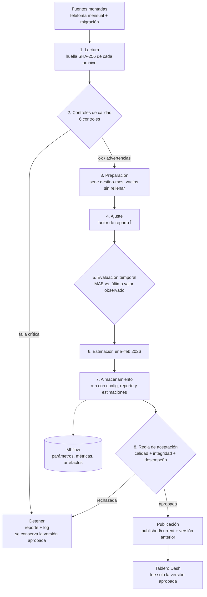

# Lab 11 — Alcance del flujo MLOps

Observatorio de Inteligencia Turística · **Grupo 1 · La Antigua Guatemala (Sacatepéquez)**.

## Qué se estima

| Elemento | Definición |
|--|--|
| Variable | Visitantes únicos del mes en el polígono **Antigua Guatemala** (telefonía móvil) |
| Unidad | Personas (visitantes únicos del mes) |
| Agregación | Destino-mes. El dato original es destino × mes × país × segmento (mayor/menor a 1 día) y se suma dentro del polígono; los segmentos y países no se traslapan |
| Meses a estimar | Enero y febrero de 2026 (sin cobertura de telefonía) |
| Archivo para el tablero | `mlops/published/current/estimates.csv` (versión aprobada) |

No se suman subdestinos (Jocotenango y Volcán Acatenango-Fuego): una persona que estuvo en dos
polígonos aparece en ambos. El total del destino se toma directamente del polígono principal.

## Fuentes y columnas

| Fuente | Hoja | Columnas | Uso |
|--|--|--|--|
| `BD_moviidad_mensual.xlsx` | `Antigua` | `destino`, `anio`, `mes`, `fecha`, `pais`, `es_consecutivo`, `visitantes` | Serie observada de visitantes únicos |
| `Base_Migracion_2009-2026jun.xlsx` | `Datos` | `Año`, `Mes cod`, `Tipo de Viajero`, `Viajero` | Perfil estacional del ingreso al país (denominador del factor) |

De migración se usan **Turista + Excursionista**, la misma definición estable del Lab 1 y del tablero
del Lab 10. No se usa la base diaria de movilidad: mide presencia por día y sumarla no produce
visitantes únicos del mes.

## Procedimiento: factor de reparto

Para cada mes observado `t` se calcula el factor de reparto del destino:

```text
f_t = V_t / M_t
V_t = visitantes únicos de Antigua Guatemala en el mes t (telefonía mensual)
M_t = llegadas de turistas + excursionistas al país en el mes t (migración)
```

La estimación de un mes sin cobertura usa el promedio de los factores de ajuste y el ingreso
observado de migración en ese mes:

```text
f̂  = (1 / n) · Σ f_t        (t ∈ meses de ajuste)
V̂_t = f̂ · M_t
```

Así la migración aporta la forma estacional y la telefonía aporta la escala propia de Antigua.

## Períodos

| Período | Meses | Uso |
|--|--|--|
| Ajuste | sep–dic 2025 y mar–jun 2026 (8 meses) | Cálculo de `f̂` y factores mensuales |
| Evaluación | abr–jun 2026, con ventana expansiva | Ocultar el mes y estimarlo solo con meses anteriores ([evaluacion.md](evaluacion.md)) |
| Estimación | ene–feb 2026 | Meses publicados como «Estimación» |

Jul–ago 2026 tienen telefonía, pero la base de migración termina en junio de 2026: sin denominador
no entran al ajuste ni a la evaluación. Los meses de evaluación se ocultan uno a uno; cada factor se calcula con información disponible
antes del mes evaluado. No se calcula error para ene–feb 2026 porque no hay dato observado.

## Parámetros y supuestos

- **Factor de reparto constante** dentro de la ventana; se registra también el factor de cada mes.
- Los meses ene–feb 2026 se dejan como **vacíos** en la serie observada, nunca como cero.
- La telefonía no permite comparación interanual: sep–dic 2025 y mar–ago 2026 no repiten meses.
- La serie de migración tiene una ruptura metodológica entre 2022 y 2023; el ajuste usa solo 2025–2026.
- Nacionales incluyen factor de expansión y extranjeros no; el flujo estima el total del polígono y
  no calcula proporciones entre ambos.
- No hay componentes aleatorios. La semilla queda fija en la configuración por si se agregan.
- Rutas, períodos, parámetros y umbrales están en [`mlops/config.toml`](../../mlops/config.toml).

## Diagrama del flujo



Puntos de control:

- **Validación de datos:** etapa 2, antes de preparar nada. Una falla crítica detiene el flujo.
- **Evaluación del procedimiento:** etapa 5, con meses observados ocultos.
- **Autorización de la publicación:** etapa 8; solo una versión aprobada reemplaza a `current/`.

## Controles de calidad

| Control | Qué verifica | Advertencia | Detiene |
|--|--|--|--|
| Columnas y tipos | Columnas indispensables y tipos numéricos/fecha | — | Falta una columna o tipo incompatible |
| Fechas y cobertura | Fechas válidas y meses de ajuste/estimación presentes | Hay telefonía en meses fuera de la configuración | Fecha inválida o mes necesario sin datos |
| Unicidad | Clave `destino, fecha, pais, es_consecutivo` (telefonía) y clave de migración | Clave repetida en migración (se suma) | Clave repetida en telefonía o fila idéntica |
| Valores faltantes | `pais` vacío se permite y se marca «No identificado» | `pais` o `permanencia_prom` vacíos | `visitantes`, `fecha` o `Viajero` vacíos |
| Valores y denominadores | Conteos ≥ 0, finitos, migración del mes > 0 | — | Conteo negativo, no finito o denominador 0 |
| Regla metodológica | La serie viene de la base mensual (una fecha por mes, día 1, sin columna diaria) y solo del polígono principal | — | Columna diaria, fecha distinta de día 1 o polígono ausente |

Los meses sin cobertura **no** se convierten en cero. El reporte se guarda por ejecución en
`mlops/runs/<run_id>/quality_report.json` y `.md`.
