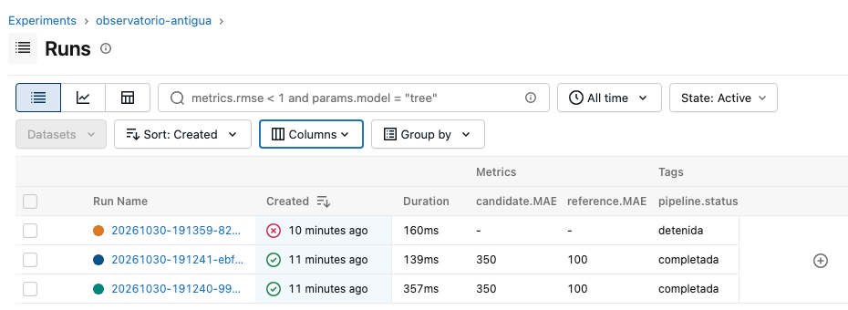

# 1. Alcance y estado de la entrega

El flujo estima visitantes únicos mensuales del polígono Antigua Guatemala para enero y febrero
de 2026, meses sin cobertura de telefonía. Integra preparación, controles, factor de reparto,
validación temporal, regla de aceptación y trazabilidad. Este documento reúne el alcance del avance,
la evaluación existente y la implementación de MLflow/Docker. No modifica las fórmulas ni los umbrales.

**Estado:** la publicación, la pestaña de Antigua, el monitoreo y la restauración todavía no están
integrados en la versión revisada. Por eso este PDF no presenta esos ejercicios como terminados.
La base mensual institucional no está en este equipo: las comprobaciones nuevas son sintéticas,
identificadas como tales. Los resultados reales de la sección 4 proceden del documento de evaluación
del equipo, no de una nueva ejecución con datos institucionales.

Fuentes editables integradas: `docs/lab11/alcance.md`, `docs/lab11/evaluacion.md` y este documento.
Código: repositorio privado `nicoCT04/Lab10-DataSicence`. Entrega prevista: 1 de noviembre de 2026.

# 2. Datos, procedimiento y flujo

| Elemento | Definición |
|--|--|
| Variable | Visitantes únicos del mes, unidad personas, agregación destino-mes |
| Telefonía | `BD_moviidad_mensual.xlsx`, hoja Antigua; destino, anio, mes, fecha, pais, es_consecutivo y visitantes |
| Migración | `Base_Migracion_2009-2026jun.xlsx`, hoja Datos; Año, Mes cod, Tipo de Viajero y Viajero |
| Ajuste | Septiembre–diciembre 2025 y marzo–junio 2026: ocho meses con ambas fuentes |
| Evaluación | Abril–junio 2026, ocultando cada mes y usando únicamente los anteriores |
| Salida candidata | `mlops/runs/<run_id>/estimates.csv`, dos filas para enero–febrero 2026 |
| Salida prevista del tablero | `mlops/published/current/estimates.csv`, solo si se autoriza y publica |

La migración usa turistas más excursionistas. Se suman países y segmentos dentro del polígono
principal, no los subdestinos, para evitar duplicar visitantes. Tampoco se suman presencias diarias
para obtener visitantes únicos mensuales. Julio–agosto 2026 quedan fuera del ajuste porque la
migración termina en junio. Los meses sin cobertura permanecen ausentes, no se rellenan con cero.

El factor de cada mes es **fₜ = Vₜ / Mₜ**; el procedimiento utiliza el promedio de esos factores
en los meses de ajuste y estima **V̂ₜ = f̂ × Mₜ**. No hay componente aleatorio; la semilla 2026 queda
registrada. El archivo `params.json` guarda los parámetros necesarios para reproducir la fórmula,
en lugar de un archivo de modelo entrenado. La versión es `factor-reparto-1.0`.

```text
Fuentes montadas → Lectura + SHA-256 → Seis controles
                                           │
                     falla crítica ────────┤
                           ↓               ↓ sin falla
                     Detener + log     Preparar serie
                           │               ↓
                           │         Ajustar y evaluar
                           │               ↓
                           │        Estimar + almacenar
                           │               ↓
                           │       Regla de aceptación
                           │          │           │
                           │       rechazo     aprobación
                           ↓          ↓           ↓
                     No reemplazar vigente     Publicar (*)
                                                   ↓
                                            Tablero Antigua (*)

MLflow registra cada ejecución, sus resultados y sus fallos.
(*) Etapas todavía pendientes de integración.
```

# 3. Controles automáticos

| Control | Criterio crítico | Advertencia permitida |
|--|--|--|
| Columnas y tipos | Falta una columna indispensable o su tipo es incompatible | Ninguna |
| Fechas y cobertura | Fecha inválida o mes necesario ausente | Telefonía fuera de los períodos configurados |
| Unicidad | Clave duplicada de telefonía o fila idéntica | Clave de migración repetida, que se agrega |
| Faltantes | Visitantes, fecha o Viajero ausentes | País o permanencia promedio ausentes |
| Valores y denominadores | Negativos, no finitos o migración mensual cero | Ninguna |
| Regla metodológica | Fuente diaria, fecha diferente del día 1 o polígono principal ausente | Ninguna |

Cada ejecución produce `quality_report.json` y su versión Markdown. Una falla crítica detiene el
flujo antes de generar estimaciones. Los resultados de todos los controles disponibles se registran
como etiquetas en MLflow; los controles no ejecutados conservan ese estado, no se consideran aprobados.

# 4. Validación temporal y regla de aceptación

La validación utiliza ventana expansiva: para cada mes de abril a junio se estima el factor solo
con meses observados anteriores. La referencia usa el último valor observado bajo la misma
restricción temporal. Ambos se comparan sobre exactamente los mismos meses. MAE y RMSE se expresan
en visitantes; MAPE, en porcentaje. Los observados cero se excluyen únicamente de MAPE y se informa
su cantidad; si todos son cero, MAPE no es calculable.

Se aprueba únicamente si: (1) no falla ningún control; (2) existen los dos meses esperados con
valores finitos y no negativos; (3) MAPE ≤ 15 %; y (4) MAE candidato / MAE referencia ≤ 1.25.
Los umbrales fueron fijados en el avance, antes de la evaluación. Para una escala cercana a
940 mil visitantes mensuales, 15 % equivale aproximadamente a 140 mil; la razón 1.25 tolera un
25 % adicional de error frente a la referencia por la incertidumbre de evaluar solo tres meses.
No se modificaron para aprobar la versión.

**Resultado institucional reportado por el equipo en `evaluacion.md`:** MAPE 7.4 % y razón MAE
1.38. Cumple el umbral absoluto, pero supera 1.25 y se **rechaza**. Las estimaciones candidatas
reportadas son 1,042,620 y 821,310 visitantes para enero y febrero. No son una versión aprobada.
Estos números se conservan como resultados documentados por el equipo, pendientes de reproducción
en este entorno cuando esté disponible la fuente mensual.

No hay telefonía de enero–febrero en ningún año ni comparación interanual. La migración presenta
una ruptura metodológica entre 2022 y 2023; se usan solo 2025–2026. La validación de abril–junio no
reproduce completamente la situación de enero–febrero. Además, el factor constante no representa
todos los cambios estacionales y la muestra de evaluación es pequeña. No se calculan errores
para meses sin observados comparables.

# 5. MLflow y reproducibilidad

Se fijó **MLflow 3.17.2**. El experimento `observatorio-antigua` almacena los siguientes elementos:

| Registro | Evidencia conservada |
|--|--|
| Identidad | ID de MLflow, ID del pipeline, inicio, fin y estado |
| Código | Commit Git; dentro de Docker se recibe mediante GIT_COMMIT |
| Datos | Archivo, hoja, filas y huella SHA-256 de cada fuente leída |
| Configuración | Períodos, procedimiento, semilla, umbrales y config.toml |
| Procedimiento | params.json con factor y meses utilizados |
| Evaluación | Métricas de candidato/referencia y evaluación mensual; decisión y motivo |
| Calidad | Estado de cada control y reportes originales |
| Entorno | environment.json con Python y versiones de dependencias instaladas |
| Artefactos | Estimaciones, serie preparada, parámetros, configuración, reportes y run_log.json |

Una detención por calidad se muestra como `FAILED` y conserva su causa. Si no alcanzó la evaluación,
no se registran métricas. Una versión rechazada por desempeño sí puede figurar como `FINISHED`,
porque terminó la evaluación; la etiqueta `acceptance.approved=False` impide confundirla con
una autorización de publicación. Los Excel originales no se copian a MLflow.

## Comprobación técnica sintética

Se utilizó la estructura de `synthetic()` de las pruebas: migración constante de 300 y telefonía
del polígono creciendo de 1000 a 1700 en los ocho meses de ajuste. Los subdestinos siguen separados.
No son conteos reales de Antigua. La tendencia permite comprobar errores distintos de cero:
MAE candidato **350**, RMSE **352.3729085310996**, MAE referencia **100**, razón **3.5**.
Ambas ejecuciones terminan, pero ambas candidatas se rechazan con los umbrales originales.

`python -m mlops.reproduce` ejecutó dos veces los mismos archivos y configuración. Comprobó huellas,
código, parámetros, evaluación, métricas y estimaciones. La diferencia máxima entre estimaciones
fue **0**; las métricas también coincidieron. Se usa tolerancia relativa `1e-12` y absoluta `1e-8`
para diferencias de punto flotante en valores y métricas; parámetros y evaluación coinciden exactamente.
Solo se excluyen ID y fecha de generación de la comparación de tablas. La equivalencia demuestra
reproducibilidad técnica, no precisión ni aceptación del procedimiento.

Se ejecutó además una copia sintética con denominador cero: el proceso terminó con código 1,
MLflow registró `FAILED`, explicó el control que falló y no agregó métricas ni estimaciones.
Las pruebas automatizadas también cubren corregir el denominador y ejecutar de nuevo.
Esto verifica detención y trazabilidad; **no demuestra todavía recuperación de una versión publicada**.

Evidencia consultable: `evidencia/comparison.json`, `evidencia/runs_export.json` y
`evidencia/mlflow_runs.txt`. La exportación contiene dos runs completos y uno fallido. Las bases
SQLite, artefactos y logs completos permanecen en los volúmenes locales; deben entregarse por
el medio autorizado junto con los registros institucionales definitivos.



# 6. Docker y ejecución desde un clon limpio

La imagen usa Python 3.14 e instala los requisitos del tablero y del flujo. Copia explícitamente
código, estilos y predicciones originales del Lab 10. `.dockerignore` excluye fuentes, cachés,
entornos, secretos, `.git` y registros; las fuentes se montan, nunca se incorporan a la imagen.

| Servicio | Función | Acceso local | Persistencia |
|--|--|--|--|
| tablero | Ejecutar Dash, sin ajustar modelos al filtrar | 127.0.0.1:8050 | data y published, solo lectura |
| pipeline | Ejecución única solicitada por comando | No expone puerto | runs, mlruns y published |
| mlflow | Consultar parámetros, métricas y artefactos | 127.0.0.1:5001 | mlruns con SQLite y artefactos |

Los comandos completos de construcción, inicio, consulta, detención y cambio de versión del código
están en el README. Se comprobó la construcción y ejecución desde un **clon local limpio del commit
de implementación**, sin copiar entornos ni resultados previos. Solo se agregaron fuentes sintéticas
montadas para el pipeline; el tablero usó el Excel de migración ya versionado.

Se comprobaron las dos corridas, la falla por denominador cero y la consulta de registros. Tras
`docker compose down` y `up`, los tres runs continuaron disponibles. Esta prueba demuestra que
la eliminación de contenedores no elimina el almacén, no que ya exista una versión aprobada restaurable.
Los puertos quedan vinculados a localhost; no se habilitó despliegue público ni acceso a microdatos.

No mezclar almacenes creados fuera y dentro de Docker: sus rutas absolutas de artefactos difieren.
Para respaldar, detener los servicios y conservar juntas las carpetas `mlruns`, `mlops/runs` y,
cuando exista publicación, `mlops/published`. La entrega de fuentes y registros institucionales se
hace por Canvas/OneDrive autorizado, no mediante enlaces públicos.

# 7. Rúbrica y pendientes de integración

| Criterio | Puntos | Estado verificable |
|--|--|--|
| Pipeline y configuración | 20 | Flujo y configuración existentes; publicación pendiente |
| Controles de calidad | 15 | Seis controles; pruebas sintéticas y detención comprobadas |
| Registro MLflow | 15 | Implementado y verificado con dos corridas y un fallo; falta repetición institucional |
| Validación y aceptación | 15 | Ventana expansiva y regla existentes; sin cambiar umbrales |
| Integración y publicación | 10 | Pendiente: publish.py y pestaña de Antigua |
| Monitoreo y recuperación | 15 | Pendiente: alertas, conservación y restauración demostrada desde el tablero |
| Docker y documentación | 10 | Tres servicios, volúmenes y prueba desde clon limpio; documentación de restauración pendiente de su implementación |

No se asigna una nota automática. Antes de la entrega final deben integrarse la sección de fallo,
monitoreo/recuperación y tablero del compañero responsable, ejecutar con las fuentes institucionales,
entregar los registros completos y confirmar acceso privado del docente e inscripción en Canvas.

# 8. Referencias

- Equipo de proyecto. (2026). *Alcance del flujo MLOps* y *Validación temporal y regla de aceptación*.
  Documentos internos del repositorio, `docs/lab11/alcance.md` y `docs/lab11/evaluacion.md`.
- MLflow. (s. f.). *MLflow Tracking*. https://mlflow.org/docs/latest/ml/tracking
- Docker. (s. f.). *Docker Compose*. https://docs.docker.com/compose/
- Universidad del Valle de Guatemala. (2026). *Laboratorio 11: MLOps aplicado al Observatorio de
  Inteligencia Turística*. Enunciado del curso CC3084.
